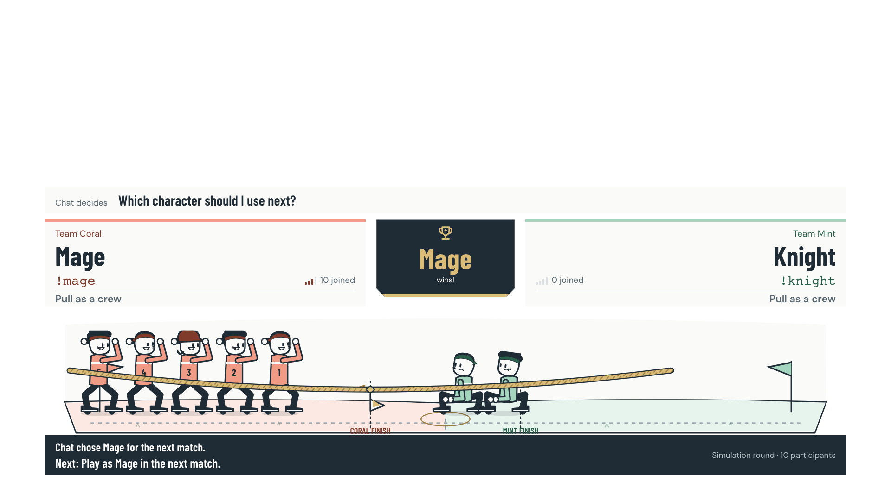
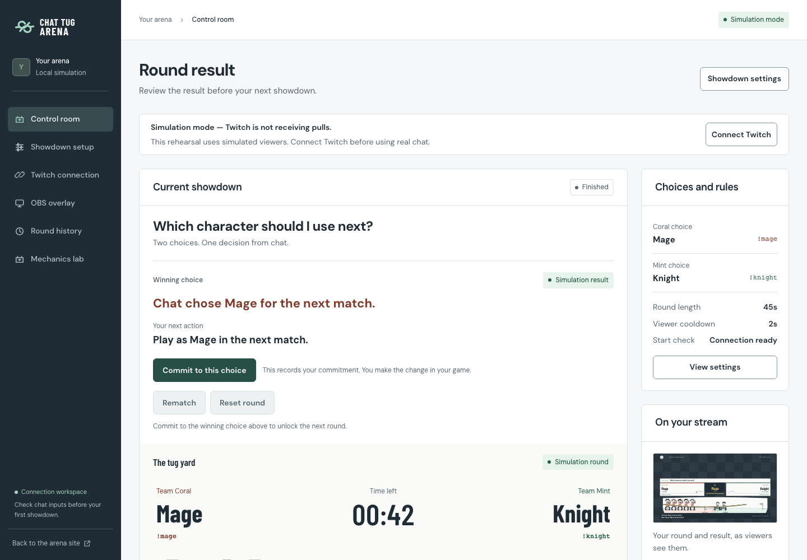

# Chat Tug Arena

**Turn Twitch chat into a pulling crew. Let the winner decide what happens next.**

Chat Tug Arena is an interactive tug-of-war for a streamer's next decision. Set two choices, let viewers pull with chat commands, then commit to the winning action. Participation builds force, the rope carries momentum, and coordinated crews can turn a round around.

Built with **OpenAI Codex** for the [Codex x TwitchCon Hackathon](https://twitchcon-codex.devpost.com/). The implementation, setup instructions and verification records are included here.

## Demo

**[Watch the Chat Tug Arena demo on YouTube](https://youtu.be/jrdV6V3SlXM)**



*Rendered product capture from a labeled local rehearsal. Real Twitch verification is documented separately below.*

## A decision viewers can play

Ask **“Which character should I use next?”** Give chat **Mage** and **Knight**, with `!coral` and `!mint` as the commands.

1. Connect the broadcaster's Twitch channel and save the showdown.
2. Start the countdown. Exact chat commands become accepted pulls after server-side fairness checks.
3. Watch pressure accelerate the rope. Force decays when participation stops; momentum settles gradually.
4. Coordinate distinct viewers for a temporary crew combo. Repeated participation still contributes, with cooldowns and diminishing returns.
5. See the server's winner and exact next action, commit to that choice, then rematch.

The streamer changes their own game. Acknowledgment records a commitment; the application does not automatically control a game or certify that the action was completed.



## What makes it different

- **A moving game:** a deterministic 20 ms simulation models position, velocity, momentum, damping and decaying team force. Coordinated input can overcome existing momentum.
- **Crew combos:** 3, 6 or 10 distinct participants within a rolling 3-second window unlock temporary 1.25×, 1.5× or 1.75× pressure. One viewer repeating a command cannot create a unique-viewer combo.
- **Fair repeated play:** per-user cooldown, duplicate Twitch ID rejection, bounded repeats, diminishing returns, team locks and burst limits protect the game without reducing participation to a single vote.
- **A useful consequence:** five editable templates cover next character, loadout, strategy, challenge and custom decisions. Winners produce a specific action the streamer can acknowledge.
- **One visual identity:** original Fieldday vector characters, grounded pulling poses, clear crew colors and reduced-motion support carry across the dashboard and read-only overlay.
- **Server authority:** clients render and interpolate the scene; they cannot choose the winning result.

Chat voting and tug-of-war voting already exist. This project's contribution is their combination with sustained momentum, distinct-viewer cooperation, visible feedback and an actionable streamer workflow.

## Verification: what is actually proven

| Area | Evidence and scope |
| --- | --- |
| Real Twitch | Actual OAuth consent, an enabled `channel.chat.message` subscription and genuine commands from **one broadcaster account**, testing both crews in separate rounds |
| Live gameplay | Opposite rope movement, measured force decay, pause/resume, time-based winners, consequences, acknowledgment and rematch |
| Live fairness | A rejected team switch and accepted long-gap repeated pulls; live inside-cooldown/diminishing behavior was not demonstrated |
| Automated checks | **147 unit/integration tests, 50 production Chromium tests**, lint, type checking, production build and 16 contrast pairs passed |
| Clean reproduction | Source-only install and full 147/50 repeated without private environment/vault files on the same macOS host; shared npm/Chromium cache, not a clean VM |
| Multiplayer mechanics | Seven deterministic seed-42 scenarios, including combo rush, late comeback, spam and connection interruption; these are **simulation**, not a live audience |
| Local load | Historical 120-second fixture load across six overlays and one dashboard after the SSE fix; this is not Twitch or native OBS performance evidence |

See the [real Twitch report](docs/LIVE_TWITCH_TEST.md), [clean-install evidence](docs/qa/phase9/clean-install.json), [final QA](docs/FINAL_QA_REPORT.md) and [security review](docs/SECURITY_REVIEW.md).

**Remaining limits:** native OBS/CEF, genuine multi-account combos/comebacks, post-secret-rotation verification, real token-expiry/revocation cases and a long broadcast soak remain unverified. Native macOS browser captures are not OBS tests. No audience-growth or engagement uplift is claimed.

## Try it locally — no credentials required

Requires **Node.js 22.9+**, npm and a browser.

```bash
git clone https://github.com/shin0343/twitch-codex-plugin-hackaton.git
cd twitch-codex-plugin-hackaton
npm ci
cp -n .env.example .env
chmod 600 .env
npm run dev
```

Open [Showdown setup](http://127.0.0.1:3000/dashboard/round), save the default choices, then open the [Control room](http://127.0.0.1:3000/dashboard).
Choose **Rehearse this showdown**, then **Start showdown**. The real local engine and SSE pipeline run with a persistent **Simulation** label. Finish the round, inspect the next action, commit and rematch. Ties and no-participation results need no commitment.

For deterministic tuning, open the [Mechanics lab](http://127.0.0.1:3000/dashboard/mechanics) and run one of seven scenarios. These stop Twitch ingestion for that room and are always labeled simulation. Use a separate browser session when preserving a real round.

The connection page's **Run local simulation** is a separate input-pipeline diagnostic; it does not automatically start a game round.

### Production startup

```bash
npm run build
npm start
```

The supervisor starts both services and loads the root `.env`. Keep both processes running. Stop them with Ctrl+C.

## Connect real Twitch chat

The app uses a **confidential Twitch application**, server-side **Authorization Code OAuth**, the single scope **`user:read:chat`**, and **EventSub WebSockets**. Reader and broadcaster are the authorized account; a user access token is used for the chat subscription.

For the documented localhost setup, register this exact callback on your Twitch application:

```text
http://localhost:3000/api/auth/twitch/callback
```

Set `APP_ORIGIN=http://localhost:3000` and the matching `TWITCH_REDIRECT_URI` in your private `.env`. Enter your own app credentials with a local editor, restart both services, and open [Twitch connection](http://localhost:3000/dashboard/connection). The connection page is not the OAuth callback. Existing app owners can reuse their registered application.

Wait for **Connected / Chat subscription confirmed by Twitch**, configure and start a round, then send the exact crew command through real Twitch chat. The first accepted pull fixes that account's crew until the next round. Use a new round or another genuine account for the opposite crew. Three distinct consenting accounts are needed for a live level-one combo.

Follow [TWITCH_SETUP](docs/TWITCH_SETUP.md) for the full procedure and [LIVE_RELEASE_RUNBOOK](docs/LIVE_RELEASE_RUNBOOK.md) for recovery and recording. Never paste tokens into chat or put secrets in a browser URL.

### Environment variables

Only names and nonsecret defaults are committed. Populate real credentials locally.

| Variable | Purpose |
| --- | --- |
| `APP_ORIGIN` | Browser origin; default `http://127.0.0.1:3000`; use `http://localhost:3000` for the callback example above |
| `TWITCH_CLIENT_ID` | Server-only Twitch application identifier; blank for rehearsal |
| `TWITCH_CLIENT_SECRET` | Server-only confidential application secret; blank for rehearsal |
| `TWITCH_REDIRECT_URI` | Exact registered callback: `APP_ORIGIN` + `/api/auth/twitch/callback` |
| `SESSION_ENCRYPTION_KEY` | Stable 64-hex-character vault key; required for configured Twitch in production |
| `REALTIME_HOST`, `REALTIME_PORT` | Private backend listener; defaults `127.0.0.1:3001` |
| `REALTIME_INTERNAL_URL` | Next build-time API proxy destination; default `http://127.0.0.1:3001` |
| `DATA_DIRECTORY` | Private vault path relative to the realtime workspace; default `.data`, under `apps/realtime` |

To initialize a **blank** vault key without printing it, after creating `.env`:

```bash
node --input-type=module <<'NODE'
import { randomBytes } from 'node:crypto';
import { readFileSync, writeFileSync, chmodSync } from 'node:fs';
const file = '.env';
let text = readFileSync(file, 'utf8');
if (/^SESSION_ENCRYPTION_KEY=\s*$/m.test(text)) {
  text = text.replace(/^SESSION_ENCRYPTION_KEY=\s*$/m,
    'SESSION_ENCRYPTION_KEY=' + randomBytes(32).toString('hex'));
  writeFileSync(file, text, { mode: 0o600 });
}
chmodSync(file, 0o600);
NODE
```

Keep the key stable once authorization is stored. Never use `NEXT_PUBLIC_` for credentials. `.env`, the encrypted vault, private recordings, build output and browser traces stay outside Git.

## Read-only overlay and recording

Open `/dashboard/overlay` in the same authenticated browser and select **Copy arena source URL**. The generated route is `/overlay#room=<private read capability>`; the fragment is not a broadcaster control credential, but still keep it private. The plain `/overlay` route is a disconnected shell. `?preview=1` adds a preview background and should not be used as the broadcast source.

For an OBS Browser Source, use **1920×1080** or **1280×720**, leave the background transparent, and keep the source active during play. The scene scales as one 16:9 composition with stream-safe margins. The source reconnects to authoritative state after refresh; a server restart clears the round and requires a newly copied URL.

OBS is optional for trying or recording the browser experience. macOS screen recording or Recordly can capture the actual dashboard and source. These recordings do not certify native OBS behavior. Keep address bars, developer tools, private tabs and secret-bearing conversation turns outside footage. Simulation must remain labeled.

## Architecture and authority

```text
Actual Twitch chat
  → EventSub WebSocket
  → normalization, exact commands and duplicate checks
  → cooldown / repeat / team / burst validation
  → fixed-step authoritative engine
  → SSE snapshots and typed visual events
  → dashboard + interpolated read-only scene
  → frozen winner → exact action → commitment → rematch
```

- `apps/web`: Next.js, React and TypeScript; streamer controls and original SVG scene.
- `apps/realtime`: persistent Node service; OAuth, encrypted token vault, EventSub, clock, physics, results and SSE.
- `packages/contracts`: validated shared commands, snapshots and visual-event types.

Dashboard mutations require the server session, Origin and CSRF checks. The overlay uses a separate read capability and receives no control rights. State publication is bounded; a slow SSE client retains only the latest pending snapshot. The engine runs independently of browser frame rate.

Run one server instance. Game state, history and overlay links are ephemeral; the latest 20 session results are retained until expiry/restart. Authorized tokens can persist encrypted with a stable key. Public TLS hosting and horizontal scaling are not claimed. See [ARCHITECTURE](docs/ARCHITECTURE.md) and [documented formulas/constants](docs/GAME_DESIGN.md).

## How Codex contributed

Codex materially assisted with the architecture, Twitch integration, deterministic engine, fairness rules, original vector rig, dashboard workflow, physics scenarios and browser QA. Release work reproduced and fixed both an SSE backpressure failure and a cookie/CSRF rotation race, with regression tests.

The builder supplied the product brief, phase boundaries, reference constraints and acceptance criteria. The running game does not call an LLM or require an OpenAI API key. See the [Codex build log](docs/CODEX_BUILD_LOG.md) and [contribution summary](docs/CODEX_USAGE_SUMMARY.md). The verified principal Codex session identifier is retained privately for the required Devpost field; it is not published in this repository.

## Why this fits the hackathon

The [official rules](https://twitchcon-codex.devpost.com/rules) weight four criteria equally. The [resources](https://twitchcon-codex.devpost.com/resources) emphasize a working Twitch-connected experience built with Codex.

| Criterion | What a judge can inspect |
| --- | --- |
| Innovation / Idea | Momentum and decaying force turn sustained participation into an observable game; distinct-viewer combos and a next-stream action extend ordinary voting |
| Potential Impact | Streamer templates, prominent controls, actionable results and quick rematches support recurring community decisions; adoption impact is not yet measured |
| Technological Implementation | Real one-account Twitch evidence, server authority, deterministic scenarios, bounded transport and reproduced security/reliability regressions |
| Design | One original character family, coherent typography and crew colors, accessible controls, purposeful reactions and a scalable read-only scene |

The source and [demo video](https://youtu.be/jrdV6V3SlXM) are available. Entrant declarations, required Codex session details and final Devpost submission are handled separately. Publishing the source and linking a video do not confirm Devpost **Submitted** status. No finalist probability is claimed.

## Run the checks

```bash
npm run check                       # lint, types, tests, contrast and production build
npx playwright install chromium     # first browser installation, if needed
PLAYWRIGHT_PRODUCTION=1 npm run test:e2e
QA_OUTPUT_DIRECTORY=docs/qa/local npm run test:scenarios
npm audit --json
```

Stop an existing development server before switching to the production build. `REALTIME_INTERNAL_URL` is compiled into Next rewrites; rebuild when changing it. Keep `/api/events` and `/api/overlay/events` unbuffered and preserve `no-transform`.

## Documentation and rights

- [Streamer/Twitch setup](docs/TWITCH_SETUP.md) · [Release runbook](docs/LIVE_RELEASE_RUNBOOK.md)
- [Real Twitch evidence](docs/LIVE_TWITCH_TEST.md) · [QA report](docs/FINAL_QA_REPORT.md) · [Security review](docs/SECURITY_REVIEW.md)
- [Design system](DESIGN.md) · [Design audit](docs/DESIGN_AUDIT.md) · [Asset credits](docs/ASSET_CREDITS.md)
- [English submission text](docs/DEVPOST_SUBMISSION.md) · [Demo script](docs/DEMO_SCRIPT.md) · [Shot list](docs/DEMO_SHOT_LIST.md)
- [Current blockers](docs/FINAL_BLOCKER_STATUS.md) · [Submission audit](docs/FINAL_SUBMISSION_AUDIT.md)

Fieldday characters, rope, field, mark and icons are original project vectors. DM Sans and Barlow Condensed use **SIL OFL 1.1**; notices are included in `apps/web/public/licenses/`. No borrowed game sprites, reference artwork, music or promotional footage is shipped.

A project-wide open-source license has not been selected. Public availability is not a claim that original work is MIT/CC0; preserve dependency and font notices. Source and run instructions are provided for hackathon review and testing. See the asset ledger for provenance and current limitations.
