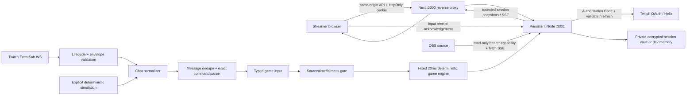

# Architecture — Phase 6 presentation over the authoritative workflow

The Phase 1 stack is retained: Next/React/TypeScript, Tailwind + semantic CSS, native Node HTTP + ws,
npm workspaces, shared runtime contracts, Vitest and Playwright. No Phase 0 architecture existed.
Phase 2 replaced the public foundation WebSocket stub with authenticated session SSE.
Twitch’s upstream transport remains EventSub WebSockets. No serverless game loop is introduced.
Phase 3 adds pure fixed-step physics and a persistent 50Hz server clock, with 10Hz authoritative snapshots.
Phase 4 adds original SVG game art and a bounded client presentation timeline; all physics, fairness and results remain server-owned.
Phase 5 adds a server-session showdown draft, exact consequence, idempotent commitment and bounded history.
Phase 6 refines presentation and navigation without changing those protocols, physics or authorization boundaries.

## Modules and ownership

| Module | Responsibility |
| --- | --- |
| `packages/contracts/src/connection.ts` | Protocol v2, eight states, normalized chat, team inputs, keyword and snapshot validation |
| `apps/realtime/src/config.ts` | Exact origin/callback validation; secret/key configuration; private backend bind |
| `sessions.ts` | Opaque session digest lookup, cookie flags, bounded TTL, encrypted atomic vault |
| `twitch-api.ts` | Official provider endpoints, fixed safe errors, minimal scopes, identity validation, single-flight refresh |
| `runtime.ts` | One-time session-bound OAuth state, callback transaction, session rotation, revocation, room ownership |
| `eventsub.ts` | Welcome/subscription, watchdog, handoff, unexpected-loss retries, schema checks and revocation |
| `pipeline.ts` | Shared normalizer, message-ID dedupe, exact command parser, bounded typed input history |
| `room.ts` | Session connection state, source exclusivity, hourly validation and realtime publication |
| `simulation.ts` | Fixed multi-viewer scenario through the normalizer and parser |
| `game/engine.ts` | Pure deterministic physics, fairness, combos, lifecycle, result and visual events |
| `game/tuning.ts` | Tested server-owned constants, thresholds and limits |
| `game/controller.ts` | Persistent monotonic clock, bounded catch-up, explicit stall pause and 10Hz publication |
| `game/scenarios.ts` | Seven seeded input plans, common playback and offline measurements |
| `packages/contracts/src/game.ts` | Snapshot/result/visual-event contracts, runtime validators and presentation-only interpolation |
| `server.ts` | HTTP/CSRF/session boundary, SSE, limits and safe evidence export |
| `apps/web/src/lib/connection-store.tsx` | Runtime-validated session bootstrap + EventSource; operational loss and recovery |
| `apps/web/src/components/connection.tsx` | Existing design primitives; connection, commands, simulation and activity |
| `apps/web/src/components/game.tsx` | Shared game art, existing lifecycle controls and developer mechanics lab |
| `apps/web/src/components/broadcast-overlay.tsx` | Cookie-free, runtime-validated read-only SSE with no control authority |
| `apps/web/src/lib/scene/presentation.ts` | Two-snapshot interpolation, per-round event dedupe, bounded cues, pose selection and result timing |
| `apps/web/src/lib/scene/rig.ts` | Deterministic connected limb geometry, planted feet and pose sampling; no game authority |
| `apps/web/src/lib/scene/preview.ts` | Drawing-only idle state for labeled previews and standby; zero viewers/events/results and no network authority |
| `apps/web/src/components/scene/game-art.tsx` | One cleanup-safe SVG animation loop, original crew/field/rope rendering; no per-frame React render |
| `apps/web/src/components/scene/broadcast-stage.tsx` | Dedicated 16:9 source HUD, aggregate participation, clock and authoritative result |
| `apps/web/public/game/` | Original reusable symbol atlas and provenance; no external character pack |
| `packages/contracts/src/showdown.ts` | Five presets, consequence/start-condition types, exact action/summary generation and runtime outcome consistency |
| `apps/realtime/src/game/showdowns.ts` | Server-result capture, immutable choice/action, idempotent commitment and latest-20 history |
| `apps/web/src/components/{round-form,showdown-result,confirm-round-action}.tsx` | Session form, useful participation, result/history and accessible destructive-action confirmation |
| `apps/web/src/app/dashboard/history/page.tsx` | Tertiary session result/commitment history |

The dashboard/setup provider opens one private stream per mounted workspace. Public landing and OBS do not get a control session.
Phase 5 showdown preferences save to the server session with both commands; local storage only retains historical preview/lab fallback data.
Ongoing rules are immutable. Server-side team commands are locked during countdown/play/pause. The capability-free overlay retains standby defaults;
the room-linked overlay receives server config/commands/clock/physics/result from its separate read-only stream.

## OAuth and token lifecycle

- Broadcaster authorizes their own channel with only `user:read:chat`. Condition broadcaster ID and reader ID both use the validated subject.
- Authorization Code flow: POST entry → Twitch consent → server exchange → validate client/scope/subject → Helix identity → rotate session and CSRF → clean redirect.
- Random 256-bit OAuth state is hashed, bound to the session, expires after ten minutes and is consumed once. Denial/mismatch/replay never authenticates.
- Random session cookies are HttpOnly, SameSite=Lax, Path=/api, 12-hour TTL, Secure on HTTPS. Only their SHA-256 digests are stored.
- State-changing requests require exact configured Origin and a session CSRF token. Callback GET instead requires OAuth state.
- Authorized startup/restored sessions validate before opening EventSub; active sessions validate hourly. HTTP 401 triggers a single shared refresh, subject validation, rotated token persistence and one retry.
- Tokens/refresh tokens/client secret never enter snapshots, browser storage or logs. Provider response text is discarded. API uses no-store/no-referrer; Next request logging is disabled.
- Disconnect stops ingestion, clears authorization, rotates cookie/CSRF and attempts provider revocation. An unconfirmed revoke is explained with a Twitch Connections recovery action.

## EventSub reliability and input contract

Connected requires welcome **and** a confirmed `channel.chat.message` v1 subscription (HTTP 202, enabled, expected condition/session).
Up to 32 early notifications can wait for the subscription response. Validated keepalives/notifications reset the watchdog.
The ws library answers Ping with Pong; no application messages are sent upstream.

Twitch-directed reconnect validates the supplied WSS host/path, opens the replacement while retaining the old socket,
then transfers subscriptions on welcome and retires the old socket. An unexpected loss opens a fresh socket and
re-subscribes, with up to five retries at 1/2/4/8/16 seconds. Missed events are not replayed.
Revocation or invalid permission stops ingestion and provides a reauthorization path.

Envelope and chat IDs are deduplicated independently (10-minute window, maximum 10,000 each).
Payloads are bounded at 64 KiB; invalid JSON/schema, wrong channel/subscription/session, stale envelope timestamps,
and foreign Shared Chat sources are rejected. Only validated message text is parsed.
The complete trimmed, case-insensitive message must equal one of two distinct `!command` values.
Substring matches, combined commands and ordinary chat are ignored. Arbitrary chat text is not broadcast to clients.

`game.input` carries sequence, source, channel/user/display name, team, command and time. It still means **recognized input**.
Phase 3 applies a second gate and records accepted/rejected decisions, distinct from the existing recognized activity. History retains the newest 40 inputs.
Inputs publish in coalesced 100ms snapshots; status changes publish immediately. Each snapshot has a revision.
Reconnect clients receive the current bounded snapshot, not an unbounded event replay.

## API and client delivery

| Endpoint | Access / result |
| --- | --- |
| `GET :3001/health` | Process/configuration health; never a global Twitch connected flag |
| `GET /api/session` | Creates/reads opaque cookie session; safe snapshot + CSRF |
| `POST /api/auth/twitch/start` | Origin + CSRF; 303 to real Twitch consent |
| `GET /api/auth/twitch/callback` | Session/state validation; always returns to clean connection URL |
| `GET /api/events` | Session cookie, same-site/origin check; read-only SSE |
| `POST /api/twitch/reconnect`, `/disconnect` | Session + Origin + CSRF; validated resume or credential removal |
| `POST /api/commands` | Session + Origin + CSRF; field-specific 422 or normalized commands |
| `POST /api/simulation/start`, `/stop` | Same authenticated controls; source stays labeled simulation |
| `POST /api/evidence/ack` | Same controls; acknowledges a matching real-origin team input seen by client |
| `GET /api/evidence` | Safe JSON only after connected real-origin input + matching client acknowledgement; otherwise 409 BLOCKED |
| `POST /api/game/prepare`, `/start`, `/pause`, `/resume`, `/abandon`, `/reset`, `/rematch` | Control session + exact Origin + CSRF; expected round ID/state; invalid or stale transition returns 409 |
| `POST /api/game/simulate` | Same controls; bounded validated seed/scenario/config; stops Twitch and explicitly labels simulation |
| `POST /api/game/test-input` | Same controls; ACTIVE simulation only; 1–12 generated distinct users per click, bounded identity text |
| `POST /api/game/configure` | Same controls + expected settings revision; validated question/choices/commands/consequence/start-condition save together |
| `POST /api/game/finish` | Same controls; ACTIVE or active-paused only; server evaluates current position, ties and no-play |
| `POST /api/game/commit` | Same controls; current finished winner only; records one immutable commitment timestamp, no client-supplied action/winner |
| `POST /api/game/rehearse`, `/rehearsal-check` | Saved draft becomes labeled simulation READY; bounded automated input plan begins only after Start; check is READY simulation only |
| `GET /api/game/overlay-key` | Streamer cookie; obtains a separate read-only room capability |
| `GET /api/overlay`, `/api/overlay/events` | Bearer capability only; no control cookie needed, no private receipts or authorization data |

SSE uses 15s heartbeats, a six-stream/session bound, slow-consumer close, no-cache and **no-transform**.
Next’s default gzip otherwise buffers small frames: this was reproduced and fixed in browser QA.
The browser marks updates unavailable on EventSource errors or a >40s heartbeat gap, and removes green connection confirmation.
Session rotation closes old streams and triggers a fresh bootstrap. Unknown/public WebSocket upgrades are rejected.
Control requests are bounded at 4 KiB and 30/minute/session; global sessions are bounded at 256.

The evidence endpoint does not substitute for a human live test. Fixtures use `test_fixture`; simulation cannot pass.
The repository’s current live verification remains BLOCKED; see QA_PHASE_2.

## Determinism, game clock and presentation

The pure engine accepts supplied elapsed milliseconds and validated typed input, without reading time, generating randomness,
performing I/O or allocating snapshots on a tick. Server receipt order and the fixed tick at which an input arrives define replay order.
Running the same ordered inputs at the same simulation offsets with 1/7/16/20/33/50/100/500ms update chunks produces identical snapshots.
Twitch event occurrence time is a freshness/start/resume gate, not permission to insert force retroactively.
Physics and all constants/formulas are documented in GAME_DESIGN. No loss-dependent force or hidden winner adjustment exists.

Each prepared room owns one `GameController`. Its monotonic timer accumulates partial elapsed time and runs 20ms steps.
Tick work mutates scalar force/position/velocity and bounded participant/combo maps; incoming bursts add to scalar pending impulses.
No growing input queue or per-message timer. The driver publishes every 100ms and immediately on state changes; connection pipeline
updates remain coalesced. Long delays >1000ms explicitly pause instead of silently discarding an active match interval or integrating
an unbounded catch-up burst. Paused rounds keep a bounded clock driver for their 60s abandonment deadline.
Timers stop at finish, reset, source changes, room expiry and shutdown. Idle/ready rooms have no game timer.

Only server ticks finish a game. The result contains round ID, reason, winner or null, final position, elapsed time and contribution counts.
Snapshot copies cannot mutate authority, including nested result/event objects. Browser inputs cannot set position/force/result.
Simulation test controls never feed live Twitch play. All game actions share the existing session lock and 30/min control limit.
The API rechecks cookie/CSRF after acquiring the lock and validates expected ID/state after pumping the authoritative clock.

`GameSnapshot` version 1 is included in actual v2 connection snapshots. It remains optional in the v2 type only for backward-compatible
connection-only fixtures; new servers always send it. Public game snapshots clear private input receipts and contain no viewer IDs,
CSRF, auth tokens or overlay key. Visual event sequence is per round; retain 64 events and recover current state/result after gaps.
Rendering interpolates two ordered same-round ACTIVE snapshots over 100ms with clamped alpha. It cannot extrapolate or choose a result.
Pause/finish/round changes snap to authority, and feed loss freezes the latest drawing and hides its advancing clock.

Twitch loss and handoff pause the round while preserving participation, accepted-ID dedupe, combo state and remaining time.
A confirmed reconnect requires explicit streamer resume; queued gap messages fail the new timestamp barrier. Same-source reconnect
does not reset the input pipeline. Source changes abandon. The scripted interruption scenario resumes by a recorded test action;
that is separate from real Twitch's explicit operator action.

## Read-only OBS capability

Phase 5 configuration/commitment are control operations. The public projection adds only the current `consequence`;
private settings revision/history remain outside it. It contains question, winning choice, exact action, commitment and source provenance,
never a control token or viewer identity. Runtime validation checks consequence against the finished game/config, not just its shape.
The OBS setup fetches a viewing key after the control feed is ready, then mounts the actual preview. Keyed iframe mounting prevents
a standby document remaining idle after a fragment-only navigation. The link is masked until explicitly revealed and never persisted.

The streamer copies `/overlay#room=<256-bit capability>` from OBS setup. The fragment stays out of HTTP requests/referrers;
the overlay uses it only in an `Authorization: Bearer` header to fixed `/api/overlay[/events]` endpoints, with `credentials: omit`.
No capability in browser storage, query string, connection snapshot or logs. The overlay page sends `no-referrer` metadata.
The source URL necessarily grants viewing access; it grants no control/session/CSRF authority. Public endpoints support GET only.
Capabilities are in memory, bounded by the existing 256 sessions and their TTL; lookup rejects expired rooms. Auth/session rotation,
disconnect and shutdown close public streams and invalidate the key. Restart requires copying a fresh link.
Six overlay subscribers per room, no-transform SSE, 15s heartbeat, slow-consumer close and bounded frame parsing mirror private delivery.
Automatic frontend retry uses fetch streaming; 40s without a signal aborts stale transport. Invalid capability/schema never implies a live state.
The ordinary `/overlay` remains the static honest standby source. Native OBS/CEF is still unverified; Chromium is exercised with a separate
cookie-free browser context. No database, animation library or new runtime dependency was added.

## Presentation, persistence and execution limits

### Phase 4 client presentation boundary

The SVG renderer caches up to ten crew nodes and writes limb/rope geometry directly; React renders snapshots, not animation frames.
One loop uses the two latest ordered authoritative snapshots, clamped 100ms interpolation and bounded local pose phase.
It stops when hidden, idle, paused, offline, reduced-motion or settled. Cleanup cancels RAF and visibility/media listeners.
No particles, filters, 3D, per-message timer or profile images. A small same-origin symbol atlas reuses heads, boots and the knot cup.
The public source receives aggregate participant counts only; deterministic slot variants contain no viewer identity.

Fresh event sequences drive at most one prioritized cue plus one short pulse per team. Cold joins and transport/pause recovery
rebase to current authority without replaying missed effects. Finished recovery shows the final result immediately; a newly observed
finish has one bounded celebration. Only `result.winner`, never interpolated position or velocity, selects victory/defeat.
Explicit offline handling aborts fetch SSE and online retries it with a single-flight guard, because an existing browser stream
can remain open through an offline transition. The existing heartbeat/watchdog remains as a second recovery path.

The dedicated source is a letterboxed 16:9 canvas with transparent outer pixels and solid label/field backplates.
Container units preserve the same scene at 1920, 1280, 960 and 640 widths; dashboard breakpoints cannot rearrange it.
`scripts/phase4-visual-qa.ts` records actual server rounds through a separate cookie-free source, saves state PNGs/motion,
and profiles a ten-character room with video disabled. Renderer timing is DOM-update JavaScript cost, not full GPU paint time.
See QA_PHASE_4 for measured results; native OBS/CEF and real Twitch remain external verification gaps.

### Server persistence

Each room retains one configured showdown draft, a monotonically increasing settings revision and at most 20 result records.
Configure validates all fields/commands before mutation and persists commands through the existing repository rollback path;
publication is held until the draft/commands agree. Stale tabs return 409 `settings_conflict`. Saved settings are session-scoped,
not durable across restart. Preparing creates a fresh engine config and captures the accepted-command counter and server timestamp.
`chat_ready` checks a recognized matching-source command occurring after that preparation; old queued commands cannot unlock Start.

Only server results create history. Capture copies winner/choice/action once, retains fixture provenance, and never accepts a client
result payload. Commit is idempotent; a pending winner blocks prepare/configure/reset/rematch/rehearse and legacy simulate paths.
Tie/no-play/cancel require no commitment. Reset retains draft/history; rematch clears participants and honors the start condition again.
Manual Finish uses the existing 0.015 tie tolerance and no-participation rule. Physics/combos/anti-spam tuning are unchanged.
Effective contributions add one scalar weight accumulator per team; this is telemetry, not an extra force or multiplier.

Dashboard offline detection closes its EventSource, freezes rendering/clock and disables control actions immediately. Online performs
a fresh bootstrap. Server play remains independent of that browser; reconnect recovers current authority instead of inventing a pause.
The result acknowledgment records intent only; no game-controller integration, execution verification, database or new runtime dependency.

Root `.env` is loaded by both the build command and supervisor. Default UI/backend ports are 3000/3001; backend binds loopback.
The Next rewrite uses build-time `REALTIME_INTERNAL_URL`. Build shared contracts before running either app.
Supervisor SIGINT/SIGTERM stops both process groups; backend aborts pending requests, timers, sockets and SSE.

With `SESSION_ENCRYPTION_KEY`, authorized records are stored in AES-256-GCM using a fresh IV and authenticated format,
atomic rename, 0600 file/0700 directory. The key stays outside the vault. Wrong key/corruption fails startup.
Default private path is `apps/realtime/.data/sessions.enc`; `.data/` is ignored. No key means explicitly disclosed dev memory mode.
Configured production Twitch refuses to start without a key. New anonymous sessions/pending anonymous OAuth and input history
do not persist across restart. Restored authorization is revalidated; no connected state is persisted.

This is one persistent process/filesystem, not multi-instance production storage. Twitch limits active sockets per app/user;
use one control session per channel while testing (tabs sharing a cookie share one room).
Public hosting/TLS proxy policies, durable game rooms, cross-process locking, native OBS, other browsers, long live soak,
and real provider verification remain unverified. Phase 3 intentionally keeps rounds ephemeral in one server process.

## Phase 7 release hardening

`ConnectionProvider` retains the current bootstrap CSRF in a ref. A completed action updates state/token only if its captured token
still matches that bootstrap; delayed responses cannot replace a rotated session. Server cookie/Origin/CSRF checks remain authoritative.

`sse.ts` shares private/public transport behavior. `write(false)` pauses writes until drain instead of declaring connection loss.
Only the latest snapshot waits; heartbeats do not replace it. A 5s blocked-consumer deadline releases the subscription, and reset
is sent before closure. Six clients per stream class, latest-state/no-replay semantics and no-transform headers remain.

Phase 7 changed no simulation constants, public capabilities, token scopes, storage model or visual system.
Read FINAL_QA_REPORT for actual 120s single-room fixture load, finite memory observations, browser profiling and unresolved external gates.

## Phase 9 v2 rotation recovery

Real-browser QA reproduced a second race: a reset-triggered bootstrap can still carry the old cookie while a rotation's Set-Cookie is in flight.
Creating an anonymous session then can overwrite the intended cookie and pair it with the wrong CSRF token.
The repository retains at most256 old-cookie digests for10s. GET session with a recently rotated cookie returns409 `session_rotating`,
without Set-Cookie or session data; stale callbacks redirect cleanly without creating another cookie. Old cookies never regain API/SSE authority.
The client retries bootstrap at250ms up to8 times, respecting abort/unmount. Existing stale-action checks remain.
Markers are bounded process memory, not a token/session alias or a new persistence dependency. Tests cover the failing HTTP case,
300 rotations/expiry, deliberate409 browser recovery and the original held-response regression.
Real OAuth/EventSub and genuine single-account A/B gameplay were subsequently verified; native OBS/multi-account gates remain separate.
