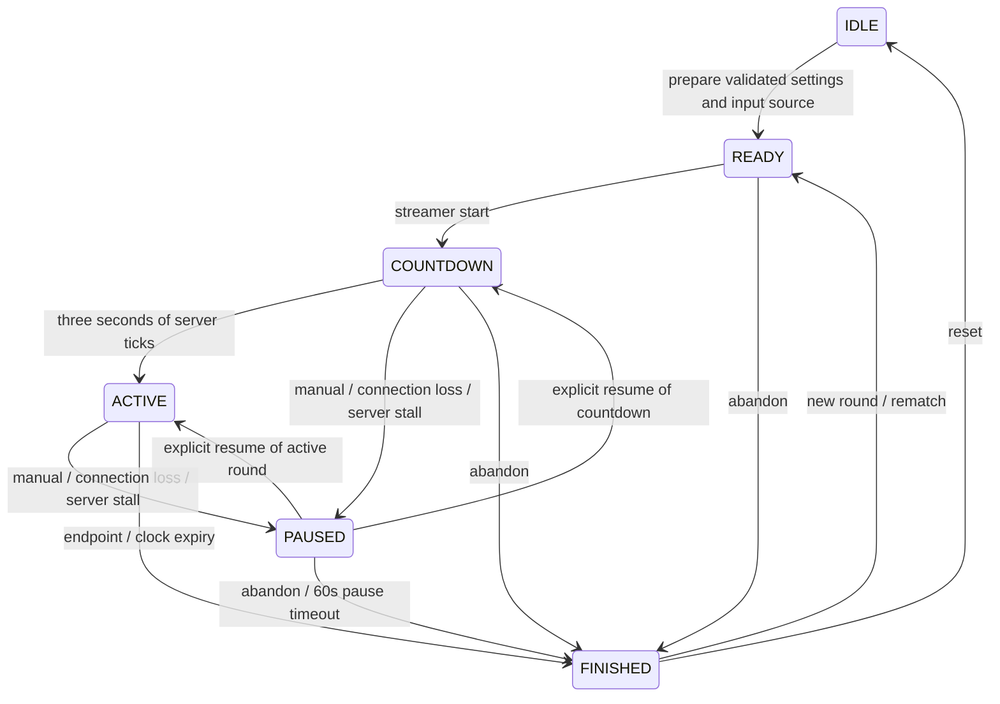

# Game Design — Phase 6 presentation, tuning version 1

Implemented authority: `apps/realtime/src/game/engine.ts`; constants: `game/tuning.ts`.
These parameters were actually simulated and tested. They are an initial balance, not a claim of live audience playtesting.
The foundation had no approved Phase 0. The existing coral/mint identities and DESIGN.md remain authoritative.

## Coordinates and physics

Coral pulls left, Mint right. Position `x ∈ [-1,1]`; the overlay coordinate is `u = (x + 1) / 2 ∈ [0,1]`.
Velocity is position units/second; momentum is `mass × velocity`. A fixed **20ms / 50Hz** server tick drives physics.
Browser frames and the **100ms / 10Hz** publication rate never drive simulation. Partial time stays in an accumulator.
The pure engine has no timers, I/O, clock reads or random calls. Timestamp parsing only validates supplied input.

At each ACTIVE tick, for each team:

```text
dt = 0.020 seconds
q_next = min(18, q × 2^(-20 / 1200) + sum(accepted pull weights) × 0.7)
F_team = q_next × combo_multiplier
acceleration = (F_mint - F_coral) × 0.16 / mass
v_next = clamp((v + acceleration × dt) × exp(-2.4 × dt), -0.7, +0.7)
x_next = clamp(x + v_next × dt, -1, +1)
```

Mass is 1. At a boundary outward velocity becomes zero. Inward force can immediately move the rope back into bounds.
Activity and velocity below `1e-8` become zero to avoid an endless numerical tail.
Activity has a 1.2-second half-life; damping preserves a brief visible coast then brings it to rest.
New participation can overcome existing velocity. There is no position bias, trailing-team boost, rubber band, hidden score,
random comeback or paid influence. A comeback is an observation of real movement, never a force modifier.

| Parameter | Tested default |
| --- | --- |
| Round length / viewer cooldown | 45s / 2s; UI accepts 30/45/60/90s and 1–5s |
| Fixed step / publication | 20ms / 100ms |
| Countdown / final countdown | 3 seconds / final 5 seconds |
| Pull impulse / maximum team activity | 0.7 / 18 |
| Activity half-life / velocity damping | 1200ms / 2.4 per second |
| Acceleration gain / mass / velocity cap | 0.16 / 1 / 0.7 units per second |
| Early endpoint win | Enabled, 400ms continuously at the endpoint |
| Time-expiration tie tolerance | `abs(x) <= 0.015` |
| Lead hysteresis / comeback deficit | 0.04 / 0.35 position units |
| Significant velocity / swing cooldown | 0.06 units per second / 3000ms |
| Pause abandonment / long server stall | 60 seconds / >1000ms |

No overtime: a tie is an honest result. At the deadline a non-tie position determines the winner. The winner can be on the
opposite side from the current velocity; position is the published, understandable win rule. With no accepted contributors,
the reason is `no_participation`, distinct from a participated `tie`. An abandon has no winner. FINISHED freezes all authority.

## Participation and fairness

The existing normalizer validates channel/user/message fields and rejects foreign Shared Chat sources. Commands are complete,
trimmed, case-insensitive matches to two distinct server-session commands. Substrings, combined commands and ordinary chat do not pull.
Display names do not identify viewers; validated Twitch user IDs do. Crew names and commands remain independent.

1. Only ACTIVE accepts input. The source and channel must match the prepared round.
2. Server receipt time and the start/resume timestamp reject pre-activation/gap messages, input more than 5s late, and timestamps
   more than 1s in the future. Late arrivals never rewrite an earlier tick or a finished result.
3. The upstream pipeline deduplicates message IDs for 10 minutes (10,000 bound); EventSub separately deduplicates envelopes.
   The engine also retains **accepted** IDs for the entire round, so replay cannot pull again even after transport reset.
4. The first accepted contribution locks the viewer's team for that round. Opposite commands are rejected, including after reconnect.
   A new round clears membership. Rejected pre-round inputs do not assign a team.
5. Enforce the configured per-viewer cooldown in ACTIVE simulation time. Pause does not refill it.
6. In a rolling 10 seconds, successive accepted pulls weigh **1, 0.7, 0.5, 0.35, 0.25**; additional pulls are rejected until an old
   pull leaves the window. A repeat remains useful; another distinct viewer contributes much more.
7. Room token bucket: 200 initial tokens, 100 tokens/ACTIVE second, one per accepted input, maximum 128 accepted per tick.
   Viewer/team checks run before consuming room allowance, so one spammer cannot exhaust it with cooldown failures.
8. Bounds: 5,000 assigned viewers and 50,000 accepted IDs/round. Never evict membership to bypass cooldown/team locking.
   On capacity, reject new work explicitly. Default 90s rounds at 100/s cannot exhaust the ID bound.

Burst order is server receipt order; the scalar pending impulses replace a growing message queue. Counters remain exact;
the newest 40 diagnostic decisions are retained, with rejected rows sampled every 16 rejections. Upstream history is separately 40.
These application limits operate after Twitch's own transport limits. They do not promise unlimited audiences or resist unlimited
distinct-account Sybil activity. No additional database is required.

## Distinct-user combos

Each team's accepted contributions feed a **3000ms rolling distinct-user window**.

| Level | Distinct users | Temporary force multiplier |
| --- | --- | --- |
| 1 | 3 | 1.25× |
| 2 | 6 | 1.50× |
| 3 | 10+ | 1.75× maximum |

One viewer can refresh their own presence but occupies one entry. Rejected pulls never count. Levels can upgrade during the
**3000ms fixed duration**, without extending its original deadline. A level does not downgrade during that duration.
Expiration emits once, removes the multiplier, clears eligibility and begins a **2000ms cooldown**. Inputs during that cooldown
still pull but cannot preload another combo. Reactivation requires fresh accepted distinct users after cooldown.
There is no per-message notification: start, upgrade and expiry are the only combo events.

## Round lifecycle



Phase 5 READY snapshots copy a validated server-session showdown draft; legacy lab scenarios can still supply their own validated config.
Settings edits never alter an ongoing round.
Commands cannot change during countdown, active play or pause. Controls carry the expected round ID **and state**; stale/double
requests return 409 rather than resetting the timer. Reset during play is rejected; abandon first. Rematch gets a fresh ID, users,
input IDs, event sequence, pressure and result; it starts a new countdown. Rematch does not replay a scripted scenario automatically.

Unexpected Twitch loss, reconnect/handoff, subscription failure and revoked authorization pause ACTIVE/COUNTDOWN.
Pressure, velocity, combo timers, cooldown and match time freeze. Chat received during pause cannot accumulate a catch-up burst.
Connected does not auto-resume: the streamer explicitly resumes after confirmed subscription. The current pipeline/engine fairness
state survives same-source reconnect. Switching to simulation/disconnecting/starting OAuth abandons any ongoing round.
The original short connection-only simulation remains available; full mechanics scenarios use the same normalizer/parser.

A monotonic persistent Node driver runs independently of any browser. A delay over 1000ms pauses with `server_lag` rather than
inventing skipped physics. It discards that exceptional delay; resume establishes a fresh server timestamp barrier. The 60s pause
timeout uses subsequent server ticks. Process shutdown abandons in-memory games; process restart starts IDLE and requires a new round.
This is deliberate bounded memory, not durable round recovery. Room/session expiration closes timers/streams.

## Visual event contract for Phase 4

`packages/contracts/src/game.ts` defines runtime-validated version-1 snapshots and discriminated events.
Each event has round ID, monotonic per-round sequence and ACTIVE elapsed milliseconds. Startup countdown events have `atMs=0`;
their phase/seconds plus sequence distinguish them. Keep the newest 64 events; clients dedupe by `(roundId, sequence)`.
After a gap, recover the latest snapshot/result rather than requiring historical effects to determine gameplay.

| Event | Trigger / bounded behavior | Implemented Phase 4 reaction |
| --- | --- | --- |
| `TEAM_COMBO_STARTED` | 3+ distinct accepted users; can start directly at a higher level | Synchronized team pull, multiplier/time strip, one 850ms accent |
| `TEAM_COMBO_UPGRADED` | Higher distinct-user threshold within the original duration | Updated multiplier/effort; one bounded accent |
| `TEAM_COMBO_EXPIRED` | Duration ends, once | Remove accent/multiplier; select pose from current pressure |
| `MOMENTUM_SWING` | Reversal between significant ±0.06 velocities; 3s event cooldown | Connected body weight shift plus one 1000ms cue |
| `COMEBACK_DETECTED` | Team trailed by ≥0.35, then crosses the opposite 0.04 lead boundary; once/team/round | One 1600ms priority cue; no force bonus |
| `TEAM_LEAD_CHANGED` | Initial ±0.04 lead or crossing opposite threshold; hysteresis suppresses centre jitter | Persistent leader label plus one 1000ms cue |
| `ROUND_COUNTDOWN` | Start 3/2/1; final 5/4/3/2/1 | Shared authoritative clock; preparing pose / final restrained pulse |
| `ROUND_FINISHED` | Exactly once, with authoritative result payload | One winner hop, defeated crew sits, result reveal; neutral tie/no-play/abandon |

Snapshot fields also cover `x`, normalized `u`, velocity/direction, momentum, per-team force/intensity, combo state, unique viewers,
match/countdown/elapsed time, tension, pause reason and result. Intensity is `F/(18×1.75)` clamped to [0,1]; tension is the smaller
team intensity, distinguishing strong opposition from a one-sided rush. Rapid motion derives from velocity; high tension derives
from this field, without generating an event every tick. Results include reason, final position, elapsed time, unique viewers and
both contribution counts. Ordinary clients have no input/result/physics write endpoint for Twitch play.

The current frontend linearly interpolates two ordered ACTIVE snapshots of the same round over 100ms. It clamps the fraction,
does not extrapolate, snaps on state/round changes, freezes on feed loss and respects reduced motion. It never infers a winner.
The Phase 4 rig adds presentation without changing these contracts, physics parameters or server result rules.

## Phase 4 scene rules

`lib/scene/presentation.ts` owns a bounded two-snapshot timeline; `rig.ts` computes connected poses;
`components/scene/game-art.tsx` updates SVG geometry in one requestAnimationFrame loop. Art is original Fieldday crew v1.0.
No new runtime dependency or server game change. See DESIGN v1.3, ASSET_CREDITS and QA_PHASE_4.

- Map `x` to `800 + 150x` for the rope pennant. Stationary finish flags are at 650 and 950; the midpoint is 800.
  Rope sag is `10 × (1 − sqrt(tension))` while held, 38 when released. Hands use that exact quadratic curve.
- Two base mascots per team grow to 3/4/5 at 3/6/10 unique viewers. Ten total is a hard render bound.
  Three head variants and jersey numbers are deterministic slots, not user identity/profile images.
- Pose priority: authoritative result → preparing countdown → active combo → losing balance → strong pull → pull → idle.
  Losing balance requires own force >0.02 and adverse position >0.52 or velocity >0.18; strong pull requires force >4.
  The losing test is team-relative. Pose state never changes the server pressure, position or result.
- Arms use two-bone IK; feet remain planted for 75% of a 24-unit stride with at most 6-unit step lift.
  Combo members share a stroke phase. No stretched static avatar or disconnected body-part animation.
- Cue priority is comeback > swing > lead. Retain one cue and two combo timestamps, dedupe by round/sequence,
  ignore effects older than 1000ms of match time and suppress all historical effects at cold join/recovery.
- Start anticipation follows the real 3000ms countdown. Local phase advances at most 100ms between snapshots,
  then stops; there is no unbounded animation clock extrapolation during transport loss.
- A decided finish uses a single 900ms hop, 450ms defeated sit and 1400ms result reveal. Winner comes only from `result.winner`.
  Late/recovered finished sources show settled results. Ties, no participation and abandonment remain neutral.
- Hidden, disconnected and paused sources stop their animation loop. Offline aborts SSE immediately; online retries it.
  Recovery rebases the timeline, discarding missed cues. Reduced motion holds poses and reveals the result immediately.
- No audio, configurable punishment, particles or camera shake. The consequence is the losing crew taking a seat.

## Phase 5 choices, finish and commitment

The server draft pairs the existing question/team-name fields with template, consequence type, optional two custom actions
(120 characters each) and a start condition. Save both exact keywords with that draft. The five templates are character,
weapon/loadout, strategy, challenge and custom community decision; a template is editable, not an automatic game integration.
Selecting one does not start a round. A confirmed source and an explicit Start remain required.

`connected` allows manual Start after preparation. `chat_ready` additionally requires a recognized, matching-source command
with occurrence time at/after preparation and sequence beyond the saved counter. Old/gap/test-before-prepare commands cannot unlock it.
The test command checks ingestion, not a pull: READY still accepts no physical contribution or participant membership.

Finish now is legal during ACTIVE or a pause from ACTIVE. It pumps the server clock then uses current authoritative position:
no participants → `no_participation`; `abs(x) <= 0.015` → `tie`; otherwise `manual`, winner from position sign.
It cannot finish the start countdown, accept a client winner, apply a new force or change any fixed-step formula above.
Cancel (`abandon`) creates no winner. Reset remains forbidden during play; confirmation UI does not replace server transition checks.

At FINISHED, capture the exact winning choice and action once. Dashboard and public overlay receive that same payload.
The broadcaster can “Commit to this choice”; timestamp is idempotent, and does not mean a game was automatically configured
or that the action has been performed. Pending commitment blocks all result-replacement routes, including legacy simulation/reset.
Ties/no-play/cancel have no action and need no commitment. Rematch produces a fresh round and repeats start-readiness checks.

Keep the latest 20 showdowns in the current server session, including fixture/simulation provenance. Reset does not erase history.
Restart/session expiration clears the ephemeral record; there is no database or cross-session history promise.
The Mechanics lab reuses saved question/choice/physics settings but omits consequence metadata from tuning scenarios.
New useful telemetry `effectiveContributions` sums accepted repeat weights before combo multiplication; raw accepted counts remain.
Neither metric creates a separate winning score. The seated losing crew remains visual art; the configured action is an explicit streamer task.

## Phase 6 presentation audit

Physics tuning version 1, event thresholds, authoritative results, publication cadence and animation durations above remain unchanged.
The settled source now names the exact winning choice in the central result, including bounded wrapping for long names.
Coordination says “Crew combo ×…”; one prioritized cue uses “Lead:”, “Momentum:” or “Comeback:” and its existing expiration.
Canvas-relative base font/line height keeps the source HUD proportional in tiny embedded previews; it never affects engine coordinates.
An idle-origin source is labeled Standby. The loading state is distinct from a lost update stream.

Landing/draft/empty-lab illustrations reuse the same Fieldday renderer. Their drawing-only `previewGame` has zero viewers,
events, force and results, with an idle source; the manual demo moves only its local drawing and retains its fixed sample clock/disclosure.
It is not a physics match and cannot publish inputs, a winner or a commitment. Full browser mechanics/transport and bounded-animation
regressions plus actual before/after game recordings are documented in DESIGN_AUDIT.

## Measured seeded scenarios

Phase 7 reran all seven seed-42 plans without tuning changes: balanced/interruption ties, Coral blowout/combo endpoint,
Mint late comeback/spam-by-time and quiet no-play. Current results: [Phase 7 scenarios](qa/phase7/scenarios.json).
The 120s fixture EventSub/HTTP/SSE run also measured 3s quiet force decay from 32.445 to 5.802 and explicit paused reconnect.
These are deterministic/local transport checks, not real Twitch participation. See [final QA](FINAL_QA_REPORT.md).

Run `npm run test:scenarios`. The server lab and offline measurements share `scenarioPlan` and `ScenarioPlayback`; seed **42**
only schedules test inputs. All values below use the tested defaults above. Full precision, team counts, rejection reasons and
velocity extrema are in `docs/qa/phase3/scenarios.json`. These are simulations, not Twitch or streamer-playtest evidence.

| Scenario | Authoritative result | ACTIVE / total clock | Final x | Applied / rejected / upstream duplicates |
| --- | --- | --- | --- | --- |
| Balanced | Tie | 45.00 / 48.00s | 0 | 114 / 0 / 0 |
| Early blowout | Coral, endpoint | 3.42 / 6.42s | -1 | 20 / 0 / 0 |
| Late comeback | Mint, endpoint | 41.70 / 44.70s | +1 | 50 / 0 / 0 |
| Team combo rush | Coral, endpoint | 4.68 / 7.68s | -1 | 20 / 9 / 0 |
| Spam attempt | Mint, time | 45.00 / 48.00s | +0.767657 | 64 / 1067 / 1087 |
| Quiet | No participation | 45.00 / 48.00s | 0 | 0 / 0 / 0 |
| Connection interruption | Tie | 45.00 / 50.00s | 0 | 108 / 12 / 0 |

Late comeback reaches **-0.631972** before recovering; the event fires once. Peak speed in the early blowout is **0.510557**,
below the 0.7 cap. The spammer contributes only 22 pulls while three Mint participants contribute 42 and win; they cannot form
a Coral combo alone. The connection scenario adds a 2s pause, rejects gap inputs and preserves the full 45s match clock.
The combo rush's nine rejections deliberately repeat existing identities inside cooldown while new joiners upgrade the combo.

`/dashboard/mechanics` exposes the rope, force, velocity, momentum, ticks, timer, combo levels, input decisions and typed events.
Choose a seed/scenario or use bounded simulation-only viewer/group pulls. Manual identities make cooldown/team locking inspectable.
The static landing demo and capability-free OBS preview remain explicitly local/standby views.
